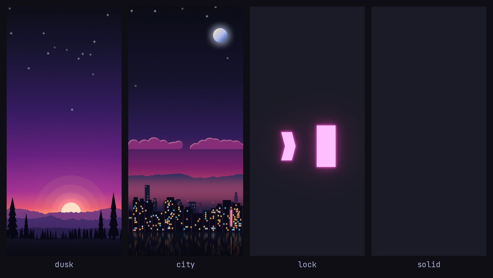

# Omatheme: Omarchy Tokyo Night for the Galaxy S25

Make a Galaxy S25 look and feel as much like [Omarchy](https://omarchy.org)'s **Tokyo Night** theme as a
stock, non-rooted phone allows, using **only apps from Google Play and Galaxy Store** (no APKs, no root).



## What's in the box

| | |
|---|---|
| [`wallpapers/`](wallpapers) | Four original wallpapers, 1440x3120 (exactly 4:3 of the S25's 1080x2340 panel): `dusk`, `city`, `lock` (a glowing shell prompt) and `solid` (`#1a1b26`) |
| [`assets/tokyo-night-palette.png`](assets/tokyo-night-palette.png) | Swatch sheet of Omarchy's exact palette, sized for the phone |
| [`docs/theme-park.md`](docs/theme-park.md) | The Tokyo Night hex value for each Good Lock → Theme Park control |
| [`termux/`](termux) | One-command Termux setup: Tokyo Night colors, JetBrainsMono Nerd Font, Omarchy's own tmux, starship and shell config |
| [`tools/`](tools) | The generator that rebuilds all of it from Omarchy's `colors.toml`, and a checker |

## What is and isn't possible

| Omarchy trait | On the S25 |
|---|---|
| Tokyo Night colors | ✅ wallpaper + One UI *Color palette* + Theme Park manual colors |
| JetBrains Mono everywhere | ❌ system-wide: Samsung's March 2026 patch only accepts Galaxy-Store-signed fonts, and the workarounds are APK-only. ✅ in Termux (same font family as Omarchy's terminals) |
| Tiled windows | ◐ two tiles with Samsung split screen or app pairs; tmux panes in Termux. No tiling window manager is installable from the stores |
| Square, thin-bordered tiles | ◐ experimental Theme Park icon plates |
| Waybar-style top bar | ❌ |

Why, with sources: [docs/limits.md](docs/limits.md). Element-by-element: [docs/omarchy-mapping.md](docs/omarchy-mapping.md).

> **Not yet tested on a phone.** This was built and checked in a cloud sandbox. [docs/limits.md](docs/limits.md)
> lists exactly what was verified and what wasn't; Samsung's menu names may differ slightly on your build.

## Setup (about 20 minutes)

### 1. Get the files onto the phone

Open this repo on GitHub in the phone's browser, open each file you want (the wallpapers, the palette
sheet) and use **Download**. The Termux part clones the repo itself (step 4).

### 2. Dark mode, wallpaper, color palette (stock settings)

1. **Settings → Display → Dark.**
2. **Settings → Wallpaper and style → Change wallpapers → Gallery.** Suggested pairing:
   *Home* `tokyo-night-dusk.png`, *Lock* `tokyo-night-city.png`. For a calmer look use `solid` (home) and
   `lock` (lock screen). Leave any "scrolling wallpaper" option off; the images are screen-shaped.
3. **Settings → Wallpaper and style → Color palette → on.** One UI derives palettes from the wallpaper.
   Pick the violet/blue one closest to the swatch sheet, tap Apply, then switch on
   **Apply palette to app icons** ([Samsung's steps](https://www.samsung.com/us/support/answer/ANS10001905/)).
4. If the wallpaper looks darker than the preview, look for a "dim wallpaper in dark mode" option under
   Wallpaper and style or Display → Dark mode (its name varies by One UI version) and turn it off.
5. Optional: **Settings → Home screen → App and widget style** to hide app labels for a cleaner look.

### 3. Theme Park for exact colors (Galaxy Store)

Galaxy Store → **Good Lock** → install, open it, install **Theme Park** (and optionally **MultiStar** for
multi-window options). Update all modules first. Then follow [docs/theme-park.md](docs/theme-park.md): it has
the Tokyo Night value for the Quick Panel, icons, keyboard and volume panel.

### 4. A terminal that looks like Omarchy's (Google Play)

Install **Termux** from Google Play, open it, then:

```sh
pkg install -y git
git clone https://github.com/nic1311/Omatheme
cd Omatheme && bash termux/setup.sh
```

Close and reopen Termux and type `t`. Details, undo and troubleshooting: [docs/termux.md](docs/termux.md).

### 5. Tiles

- **Two apps:** open Termux, then Recents → tap its icon → **Open in split screen view** → choose the second
  app. In split view, the divider handle offers to add the pair to your Home screen as an app pair (wording
  varies by version).
- **More tiles:** inside Termux, tmux panes. The **PFX** key is Ctrl+Space, then `h` / `v` split and `x` closes.

## Rebuilding the assets

```sh
python3 -m venv .venv && . .venv/bin/activate        # Python 3.11+
pip install -r tools/requirements.txt
python tools/generate.py                              # wallpapers, palette sheet, termux colors, preview
pip install materialyoucolor && python tools/verify.py
```

`tools/generate.py --theme path/to/colors.toml` accepts any Omarchy theme's `colors.toml`, though the scene
colors were tuned for Tokyo Night. Credits and licenses: [NOTICE.md](NOTICE.md).
