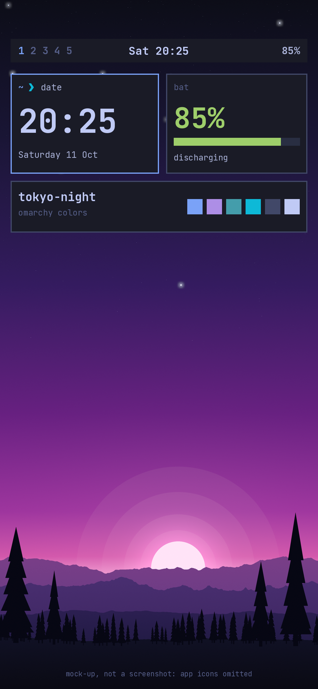

# Home screen widgets with KWGT

*Mock-up of the target look, not a screenshot. App icons are omitted and sizes are approximate.*

KWGT (search "KWGT Kustom Widget Maker" in Google Play) draws widgets from shapes and text, and it can use
a font you supply. Widgets sit on One UI Home, so **you keep your launcher**. This recipe builds an
Omarchy-style bar and bordered tiles in JetBrains Mono.

**What you get:** a Waybar-style bar and Hyprland-style tiles on the home screen, text in JetBrains Mono.
**What you don't:** a real status bar (the system one stays above it), anything inside apps, or Samsung's font
anywhere else. The widgets live on one home page.

**Cost:** building from scratch is free; importing someone else's preset needs a one-time Pro key
([Kustom docs](https://docs.kustom.rocks/docs/general_information/cracked_free)). That is why this is a recipe
and not a preset file. The preset format is not publicly documented either, so I could not have built one
without testing it in the app.

## 1. Put the font where KWGT can see it

1. In Termux run `bash ~/Omatheme/termux/setup.sh --export-font`, and allow storage access when Android asks.
   It downloads the font and saves it as `Downloads/Omatheme/JetBrainsMonoNerdFontMono-Regular.ttf`. This only
   needs the repo cloned (the README's step 4), not the rest of the Termux kit.
2. In KWGT, open Settings → App settings and note the main Kustom folder (pick one if it asks).
3. In My Files, create a folder named `fonts` inside that Kustom folder and move the TTF into it.
4. Close KWGT completely and reopen it. In the editor's font picker set the Source filter to **All**; the font
   appears as `JetBrainsMonoNerdFontMono-Regular`.
5. If it isn't listed, go to Settings → App settings and select the main Kustom folder again, then restart KWGT.
   Users report this fixes it on Android 13 and 15
   ([thread](https://forum.kustom.rocks/t/custom-fonts-not-showing-in-kwgt-editor/13297),
   [thread](https://forum.kustom.rocks/t/how-do-i-add-fonts-on-android-15/13034)).

Kustom's FAQ states the `Kustom/fonts` rule; the `Downloads` hand-off above is just how to get the file there.

## 2. Values

| Role | Hex | Used for |
|---|---|---|
| `background` | `#1a1b26` | bar and tile fill |
| `muted` | `#414868` | inactive tile border |
| `accent` | `#7aa2f7` | focused tile border, current workspace number |
| `bright_foreground` | `#c0caf5` | clock, emphasis |
| `foreground` | `#a9b1d6` | normal text |
| `dark_foreground` | `#565f89` | dim text, inactive numbers |
| `green` | `#9ece6a` | battery |
| `selection` | `#292e42` | bar track |
| `bright_cyan` | `#0db9d7` | prompt chevron |

Square corners everywhere (radius 0). Borders are thin: about 4 px on a 1080 px wide screen. In the mock-up
the clock is 112 px bold, the battery figure 96 px bold, labels 28-38 px. Kustom's size units differ from
pixels, so start from these numbers and adjust against the picture.

## 3. The widgets

Add each from the home screen: long-press → Widgets → KWGT → pick a size → tap the blank widget to edit.
For a tile, stack two rectangle shapes: one filled `#1a1b26`, one outline-only (a stroke, no fill) in the
border color. I could not confirm KWGT's exact option names for fill and stroke, so look for the paint or
style setting on the shape layer.

**Top bar** (the widest 1-row size). Leave the widget background transparent; draw a rectangle across the
full width, filled `#1a1b26`, about 60% of the widget height, at the top. Then four text layers, all bold:

| Text | Color | Where |
|---|---|---|
| `1` | `#7aa2f7` | left |
| `2 3 4 5` | `#565f89` | right after the 1 (a separate layer, so only the 1 is highlighted) |
| `$df(EEE HH:mm)$` | `#c0caf5` | centered |
| `$bi(level)$%` | `#a9b1d6` | right |

`$df(...)$` formats the date and time (use `h` instead of `HH` to follow the phone's 12/24-hour setting), and
`$bi(level)$` is the battery level ([date format docs](https://docs.kustom.rocks/docs/reference/functions/df),
[battery examples](https://forum.kustom.rocks/t/how-can-i-make-a-battery-komponent-in-klwp-kwgt/1826)). Type
straight quotes only; Kustom ignores curly ones. Optional: a `+` text in `#9ece6a` with the visibility
formula `$if(bi(charging)=1, Always, Never)$`, which shows only while charging
([thread](https://forum.kustom.rocks/t/icons-switch-help/11458)).

**Focused tile** (2x2, border `#7aa2f7`):

| Text | Color / size |
|---|---|
| `~` | `#7aa2f7`, small |
| `❯` | `#0db9d7`, small (it is in the Nerd Font Mono) |
| `date` | `#a9b1d6`, small |
| `$df(HH:mm)$` | `#c0caf5`, bold, large |
| `$df(EEEE d MMM)$` | `#a9b1d6`, small |

**Battery tile** (2x2, border `#414868`): `bat` in `#565f89`; `$bi(level)$%` in `#9ece6a`, bold, large; and
`$if(bi(charging)=1, charging, discharging)$` in `#a9b1d6`. For the bar, draw a `#292e42` rectangle as the track and a
`#9ece6a` one on top whose width is a formula of the battery level. If you find Kustom's Progress layer, use that.

**Palette tile** (4x1, border `#414868`): `tokyo-night` in `#c0caf5` bold, `omarchy colors` in `#565f89`, and six
small squares in the desktop colors: `#7aa2f7`, `#ad8ee6`, `#449dab`, `#0db9d7`, `#414868`, `#c0caf5`. (Red, orange
and yellow are Omarchy's terminal colors, not part of its desktop look.)

## 4. Notes

- **Verified from Kustom's docs and forum:** the `fonts` folder rule, the `$df()$`, `$bi()$` and `$if()$`
  forms above, and that free KWGT can build from scratch. **Not verified:** KWGT's option names for shapes
  and text, how the widgets render next to One UI 9's Home, and that the mock-up matches what KWGT draws.
- One user reports KWGT widgets receive taps on One UI Home, while KLWP (the live-wallpaper sibling) does not
  ([thread](https://forum.kustom.rocks/t/touch-not-working-samsung-fold-one-ui/8155)).
- If battery data shows in the editor but not on the home screen, see
  [this thread](https://forum.kustom.rocks/t/battery-info-works-in-editor-but-not-in-widget/13199).

## Not covered: a different launcher

Lawnchair (on Google Play) can put the font on app labels and offers a "Sharp square" icon shape, but replacing
One UI Home has costs: see [limits.md](limits.md#launchers).
